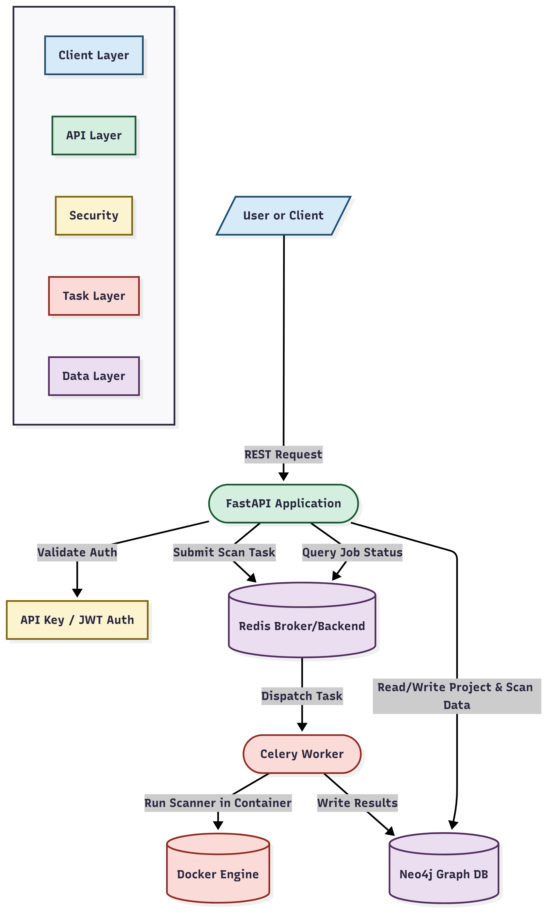

# PSTVA – Security Assessment Toolkit

[](LICENSE)

A web platform that runs security scanners (Nmap, Nikto, FFuF, Horusec, ADenum, Kerbrute) in isolated Docker containers and stores the results as a graph in Neo4j. Hosts, services, web paths and vulnerabilities are linked per project, browsable in the UI, and exportable as a PDF report.



**Stack:** FastAPI · Celery + Redis · Neo4j · React · Traefik · Docker

## Quick start

Requires Docker with Docker Compose and `make`.

```bash
git clone https://github.com/Aegis-IT-Research/PSTVA.git
cd PSTVA
cp .env.example .env      # then change NEO4J_PASS, JWT_SECRET, APP_USER, APP_PASSWORD
make boot-start           # build images, start services, follow logs
```

Open **http://curium.localhost** and log in with `APP_USER` / `APP_PASSWORD` from `.env`.

| | |
|---|---|
| Web UI | http://curium.localhost |
| API docs | http://curium.localhost/back/docs |
| Celery monitor | http://curium.localhost/flower |

`make help` lists all commands (`start`, `stop`, `logs`, …). Code layout and per-module docs: [documentation/MODULES.md](documentation/MODULES.md).

## Legal

Only scan systems you own or are explicitly authorized to test.

## License

[Apache 2.0 with Commons Clause](LICENSE): free to use, modify and share, but not to sell.
