# Database

# Data Model (Neo4j) — Core + Network + Web

This database stores the output of multiple security tools (nmap/nikto/nuclei/etc.), merges it into a single knowledge graph per **Project**, and preserves provenance so every fact/finding can be traced back to the tool run and raw output.

## Design goals

- **Project-first:** everything belongs to one project (HTB box, client scope, lab).
- **Host-id driven:** tools write results under a provided `Host.id` (currently the IP address).
- **Knowledge graph visualization:** default view shows entities (hosts/ports/services/web surface/findings); provenance is expandable.
- **Append-only enrichment:** later tools add new info without breaking existing data.
- **Future-proof:** new “mini-graphs” (e.g., Active Directory) plug in via shared anchors.

## Core schema (provenance spine)

### Nodes

**Project**

- `id` _(string, unique)_
- `name` _(string)_
- `created_at` _(datetime)_

**ToolRun**

- `id` _(string, unique)_
- `tool` _(string)_
- `version` _(string, optional)_
- `args` _(string, optional)_
- `started_at` _(datetime)_
- `finished_at` _(datetime, optional)_
- `exit_code` _(int, optional)_

**Artifact** (raw output stored in Neo4j for now; outputs ≤ ~1MB)

- `id` _(string, unique)_
- `kind` _(string)_ — `nmap_xml`, `nikto_txt`, `nuclei_jsonl`, etc.
- `created_at` _(datetime)_
- `sha256` _(string, optional but recommended)_
- `raw_text` _(string)_ ✅ full raw output
- `size_bytes` _(int, optional)_
- `truncated` _(boolean, optional)_

**Finding**

- `uid` _(string, unique)_
- `title` _(string)_
- `severity` _(string)_ — `info/low/medium/high/critical`
- `category` _(string)_ — `tls/smb/web/misconfig/...`
- `cve` _(string, optional)_
- `cvss` _(float, optional)_
- `status` _(string)_ — `open/accepted/false_positive/fixed`
- `first_seen` _(datetime)_
- `last_seen` _(datetime)_

**Evidence**

- `id` _(string, unique)_
- `kind` _(string)_ — `snippet/banner/http_response/...`
- `summary` _(string)_
- `snippet` _(string, optional; keep small)_
- `line_start` _(int, optional)_
- `line_end` _(int, optional)_
- `json_pointer` _(string, optional)_
- `created_at` _(datetime)_

### Relationships

- `(Project)-[:HAS_RUN]->(ToolRun)`
- `(Project)-[:HAS_FINDINGS]->(Finding)`
- `(ToolRun)-[:PRODUCED]->(Artifact)`
- `(ToolRun)-[:FOUND]->(Finding)`
- `(Finding)-[:SUPPORTED_BY]->(Evidence)`
- `(Evidence)-[:FROM_RUN]->(ToolRun)`
- `(Evidence)-[:FROM_ARTIFACT]->(Artifact)` _(optional but recommended)_

### Graph

## Network schema (host / ports / services)

**Simplified for now:** IPs are treated as globally unique, and the IP address itself is used as `Host.id`. This avoids an `IP` node for now; later you can reintroduce an IP/subnet model if needed.

### Nodes

**Host** (DB id you pass to tools; for now this is the IP address)
- `id` _(string, unique)_ — **IP address** (treated as unique)
- `created_at` _(datetime)_
- `last_seen` _(datetime)_
- `tags` _(list< string >, optional)_

**DNSName**

- `fqdn` _(string)_

**Identifier**

- `type` _(string)_ — `mac`, `ssh_hostkey_fp`, `smb_machine_guid`, `ad_guid`, etc.
- `value` _(string)_

**Port** (proto+port on a Host; visualization hub)

- `uid` _(string, unique)_ — recommended: `projectId:hostId:proto:port`
- `proto` _(string)_ — `tcp` / `udp`
- `port` _(int)_
- `state` _(string)_ — `open/filtered/closed/unknown`
- `first_seen` _(datetime)_
- `last_seen` _(datetime)_

**Service**

- `uid` _(string, unique)_ — recommended: `projectId:hostId:proto:port[:serviceName]`
- `name` _(string)_ — `ssh/http/smb/ldap/...`
- `product` _(string, optional)_
- `version` _(string, optional)_
- `banner_hash` _(string, optional)_
- `first_seen` _(datetime)_
- `last_seen` _(datetime)_

**CPE**

- `uri` _(string, unique)_

**Certificate** _(optional)_

- `sha256` _(string, unique)_
- `subject` _(string, optional)_
- `issuer` _(string, optional)_
- `not_before` _(datetime, optional)_
- `not_after` _(datetime, optional)_

### Relationships

- `(Project)-[:HAS_HOST]->(Host)`
- `(ToolRun)-[:SCANNED]->(Host)`
- `(Host)-[:HAS_NAME {first_seen,last_seen}]->(DNSName)`
- `(Host)-[:HAS_ID {first_seen,last_seen,confidence}]->(Identifier)`
- `(Host)-[:HAS_PORT]->(Port)`
- `(Port)-[:RUNS]->(Service)` _(allow 0.._ services per port)*
- `(Service)-[:HAS_CPE {first_seen,last_seen,confidence,source_tool?}]->(CPE)`
- `(Service)-[:USES_CERT]->(Certificate)` _(optional)_
- `(Host)-[:HAS_FINDING]->(Finding)`
- `(Port)-[:HAS_FINDING]->(Finding)`
- `(Service)-[:HAS_FINDING]->(Finding)`

### Diagram

## Web schema (web surface + tech + deep findings)

This is an “extension island” that attaches to the network layer via **HTTP(S) Service** and reuses `DNSName` as the vhost node.

### Nodes

**WebSite**

- `uid` _(string, unique)_ — recommended: `projectId:serviceUid`
- `scheme` _(string)_ — `http` / `https`
- `first_seen` _(datetime)_
- `last_seen` _(datetime)_

**URL**

- `uid` _(string, unique)_ — `projectId:normalized_url`
- `url` _(string)_ (normalized)
- `path` _(string)_
- `status_last` _(int, optional)_
- `first_seen` _(datetime)_
- `last_seen` _(datetime)_

**Route** _(optional but useful for de-dup)_

- `uid` _(string, unique)_ — `projectId:vhostFqdn:method:path_template`
- `method` _(string)_ — `GET/POST/...`
- `path_template` _(string)_ — e.g. `/api/users/{id}`

**InputPoint** _(optional; best for in-depth pentest)_

- `uid` _(string, unique)_ — `routeUid:location:name`
- `location` _(string)_ — `query/body/header/cookie/path`
- `name` _(string)_

**Technology**

- `uid` _(string, unique)_ — e.g. `WordPress:6.4.2` or `nginx:1.18`
- `name` _(string)_
- `version` _(string, optional)_

_(Optional for deeper work later: `HTTPTransaction`, `Cookie`, `Header`, `WebResource` — can be added without changing this core.)_

### Relationships

- `(Service)-[:HOSTS]->(WebSite)` _(Service is http/https)_
- `(WebSite)-[:HAS_VHOST]->(DNSName)` _(reuse DNSName as virtual host)_
- `(DNSName)-[:HAS_URL]->(URL)`
- `(URL)-[:MAPS_TO]->(Route)` _(optional)_
- `(Route)-[:HAS_INPUT]->(InputPoint)` _(optional)_
- `(WebSite)-[:USES_TECH]->(Technology)`

Findings attach where they belong:

- `(WebSite)-[:HAS_FINDING]->(Finding)` (site-wide issues, headers, TLS posture)
- `(URL)-[:HAS_FINDING]->(Finding)` (exposed endpoints, directory listing, sensitive files)
- `(Route)-[:HAS_FINDING]->(Finding)` (SQLi on endpoint, authz issues)
- `(InputPoint)-[:HAS_FINDING]->(Finding)` (XSS/SQLi on specific param/header/cookie)

### Diagram

## Visual schema diagrams

### Combined class diagram (Core + Network + Web)

